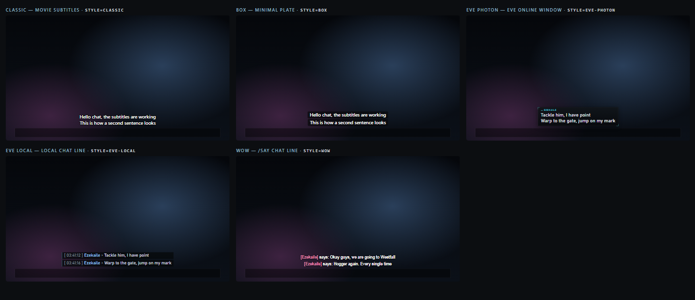
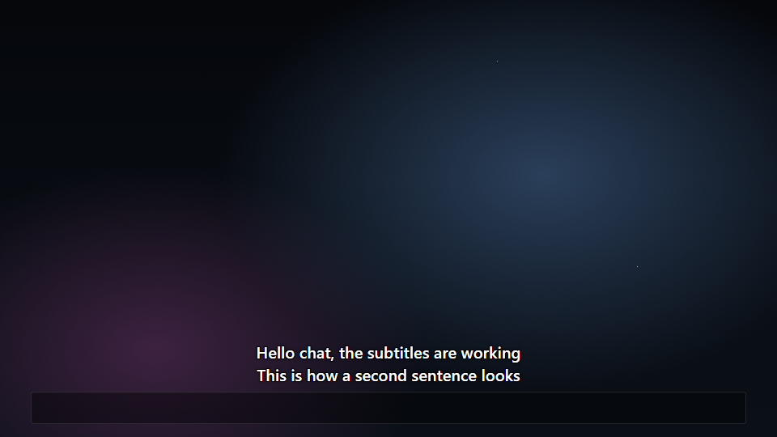
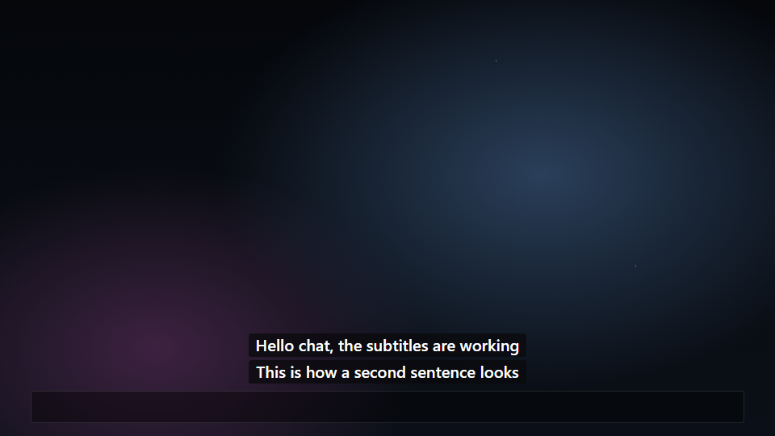
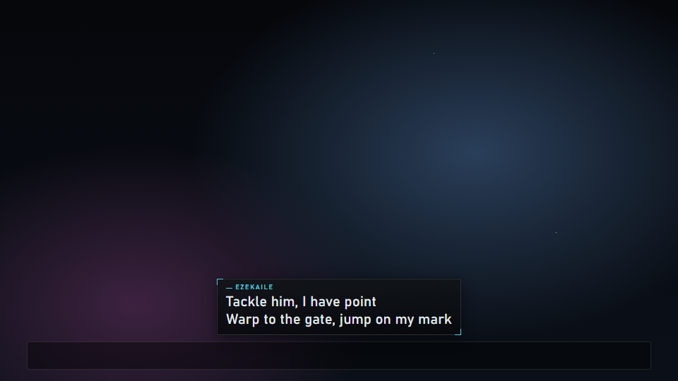
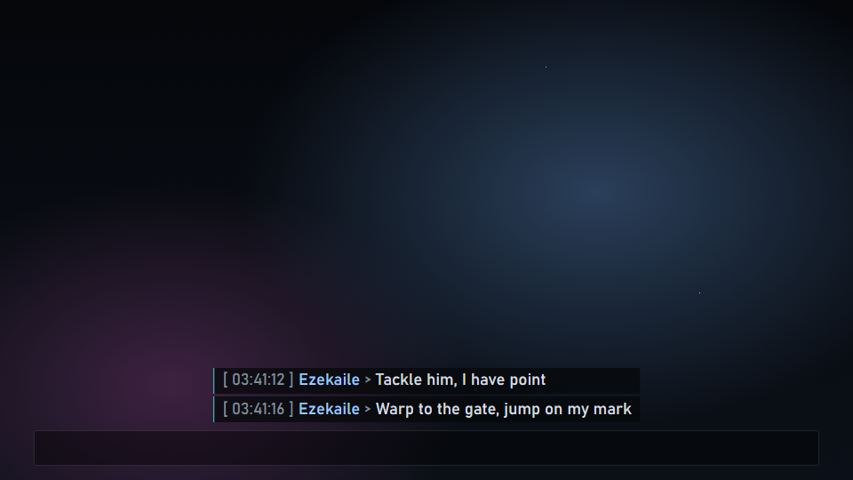
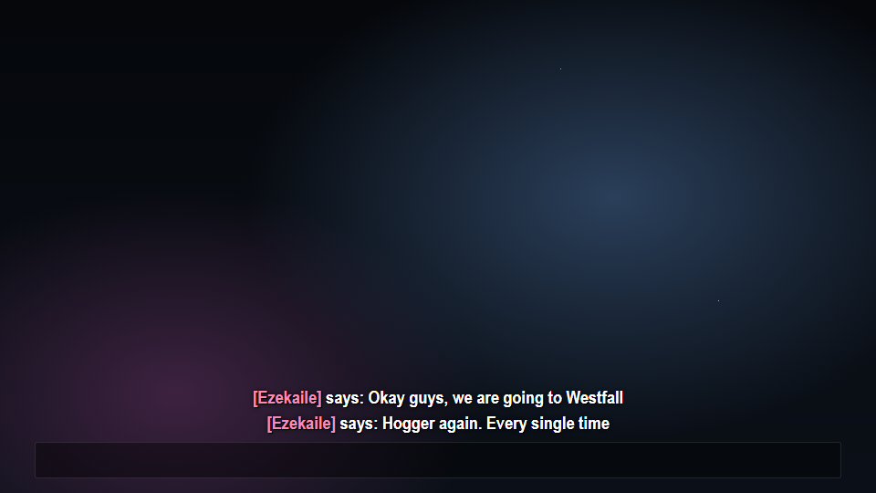

# Live Subtitles for OBS

**Английские субтитры вашей речи прямо на стриме.** Вы говорите по-русски (или по-украински, по-польски, по-немецки…), зрители читают по-английски.

> **Что это.** Готовая обёртка, чтобы стримеру было быстро поставить живые субтитры. Распознавание и перевод — не мои: это делает [LocalVocal](https://github.com/royshil/obs-localvocal) (Roy Shilkrot), который запускает [OpenAI Whisper](https://github.com/openai/whisper) через [whisper.cpp](https://github.com/ggml-org/whisper.cpp) у вас на компьютере. Live Subtitles добавляет:
> - установщик;
> - скрипт OBS, который настраивает LocalVocal одной кнопкой;
> - оверлей со стилями;
> - наборы сленга и фильтр мата.
>
> Всё, на чём это построено, перечислено в [CREDITS.md](CREDITS.md).

[English version — README.md](README.md)

- **По умолчанию базовый стиль** — как киношные субтитры. По желанию: плашка, EVE Online (окно интерфейса или строка Local) и World of Warcraft (строка `/say` с вашим ником).
- **Ваш ник на экране** в стилях EVE и WoW, своим цветом. Размер шрифта, место, ширина, число строк и время затухания настраиваются.
- **Наборы сленга — по желанию.** Whisper переводит игровой сленг дословно: «Пробки на скане» — "traffic jams on the scan", «Фортик» — "Portico". Наборы EVE и WoW возвращают это в "probes on d-scan" и "Fortizar". Набор под свою игру — несколько строк.
- **Мат — звёздочками той же длины:** английский, русский, транслит, оскорбления и свои слова.
- **Всё на вашем компьютере.** Без облака, аккаунтов, ключей, Node и Python.

## Установка на Windows (2 минуты)

1. Скачайте **`LiveSubtitlesSetup.exe`** в [Releases](../../releases/latest). Если у вас не открывается huggingface.co, берите **`LiveSubtitlesSetup-offline.exe`**: модель Whisper уже внутри (540 МБ).
2. **Закройте OBS** и запустите установщик. Windows может написать «Система Windows защитила ваш компьютер»: у установщика нет цифровой подписи. Нажмите **Подробнее → Выполнить в любом случае**. Код установщика и скрипт сборки лежат в [`installer/`](installer/).
3. Выберите **стиль субтитров**: по умолчанию *Базовый*, или *EVE Online*, или *World of Warcraft*. По желанию впишите **ник** и нажмите **Установить**. Установщик:
   - копирует модуль в **папку установки**: по умолчанию `%LOCALAPPDATA%\Programs\LiveSubtitles`, а кнопкой **Обзор…** — любую папку на любом диске;
   - кладёт модель Whisper в папку `models` внутри неё, чтобы ничего большого не шло на диск C:. Скрипт отдаёт этот файл LocalVocal. Модель установщик скачивает с Hugging Face и проверяет SHA-256, берёт из сборки -offline или использует копию, которую LocalVocal уже скачал;
   - если LocalVocal не установлен — скачивает его официальный установщик с GitHub и запускает (пройдите его до конца);
   - добавляет скрипт в текущую коллекцию сцен OBS (копия коллекции до правки остаётся рядом).
4. Откройте OBS → **Сервис → Скрипты** → `live-subtitles.lua`. Выберите **микрофон** и нажмите **Настроить всё**, потом **Показать тест**. Дальше просто говорите: английский текст появляется примерно через секунду после фразы.

Права администратора установщику не нужны (их попросит только установщик LocalVocal). Для обновления запустите установщик ещё раз: он сам предложит папку, где Live Subtitles уже стоит, а ваш набор (`packs/custom.*`) останется.

Чтобы субтитры были и в других сценах, добавьте туда существующий источник: **+ → Браузер → Добавить существующий → Live Subtitles**.

### Ручная установка (любая ОС)

1. Поставьте LocalVocal со страницы [релизов](https://github.com/royshil/obs-localvocal/releases/latest). Для Windows берите `obs-localvocal-…-windows-x64-generic-Installer.exe` — работает на любой видеокарте через Vulkan; у NVIDIA можно `…-nvidia-Installer.exe` (CUDA). OBS на время установки закройте. Если плагин не загрузился — поставьте [Microsoft Visual C++ runtime](https://aka.ms/vs/17/release/vc_redist.x64.exe).
2. Распакуйте `live-subtitles-<версия>.zip` из Releases туда, где он будет жить. Подойдёт любой путь, кириллица и пробелы тоже.
3. В OBS: **Сервис → Скрипты → +** → `live-subtitles.lua`. Выберите микрофон, стиль и, по желанию, набор, нажмите **Настроить всё**. В первый раз LocalVocal скачает модель Whisper (514 МБ) — дождитесь окна загрузки.

## Что нужно

- **OBS Studio 32 или новее.** Проверено на Windows 10/11. macOS и Linux должны работать с ручной установкой, но не проверялись.
- **Видеокарта — очень желательна.** Whisper Medium переводит примерно за секунду на видеокарте (AMD, NVIDIA или Intel, через Vulkan). На процессоре он отстаёт от речи — там лучше модель Small.
- Около 600 МБ на диске под модель.

## Настройки

| Настройка | Что делает |
|---|---|
| Микрофон | Где слушает LocalVocal. |
| Модель Whisper | Medium (по умолчанию) — лучший перевод, нужна видеокарта. Small — для слабых ПК. Large v3 — лучше всех, но тяжёлая. Если файл модели лежит в папке `models` модуля (туда его кладёт установщик), LocalVocal берёт его; иначе находит или скачивает модель сам. «Не менять» оставляет модель LocalVocal как есть. Файл модели, который вы сами выбрали в LocalVocal, не заменяется никогда. |
| Считать на | Видеокарта (по умолчанию) или процессор. Сам LocalVocal, пока это не поменять, считает только на процессоре. |
| Язык речи, Переводить на английский | На каком языке вы говорите. Без перевода получатся субтитры на вашем языке. |
| Стиль | `classic` (по умолчанию), `box`, `eve-photon`, `eve-local`, `wow` — см. ниже. |
| Ник говорящего, Ник на экране, цвет ника | Ник в стилях EVE и WoW; «показывать» добавляет его и в остальные стили. |
| Размер шрифта | Пиксели кадра 1080p (по умолчанию 40). Оверлей растягивается на ваш холст, поэтому размер одинаковый при любом разрешении. |
| Шрифт | Пусто — шрифт стиля: Bahnschrift и Segoe UI есть в Windows, Arial Narrow ставится с Microsoft Office (без него — Arial). |
| Где, Выравнивание, Отступ, Ширина | Место субтитров: внизу, вверху или посередине; отступ и ширина — в % экрана. Уберите их с интерфейса игры. |
| Строк на экране | 1–4: новая фраза — новая строка. |
| Гаснет через | Секунды тишины до затухания (0 — когда LocalVocal очистил текст). |
| Цвет рамки | Акцентный цвет стилей EVE. |
| Наборы | Наборы сленга из папки `packs`, галка на каждый файл; по умолчанию не отмечен ни один. |
| Мат звёздочками, Свои слова | Звёздочки на мат; свой список — имена, ники, что угодно. |
| Текст от LocalVocal, Оверлей | Имена источников. Менять, только если ваш LocalVocal уже пишет в другой текстовый источник. Браузерный источник, который не оверлей Live Subtitles, скрипт не переписывает. |

Изменения сразу доходят до оверлея. Набор, язык и модель уходят в фильтр LocalVocal, поэтому после их смены нужно снова нажать **Настроить всё**.

## Стили

| | |
|---|---|
|  `classic` (по умолчанию) — киношные субтитры |  `box` — текст на плашке |
|  `eve-photon` — окно интерфейса EVE Online |  `eve-local` — строка Local из EVE |
|  `wow` — World of Warcraft `[Ник] says: …` | |

`preview.html` (открыть двойным кликом) показывает все стили рядом — с вашим ником, размером и своей фразой. Сам оверлей тоже открывается в браузере: `overlay/overlay.html?demo=1&style=eve-photon&name=Ezekaile`.

## Наборы сленга

Набор — два файла в `packs/`:

- `<id>.js` — исправления перевода Whisper: пары `[регулярка, замена]`. Регулярки без учёта регистра, применяются по порядку.
- `<id>.prompt.txt` — подсказка Whisper: имена и термины через запятую. Самое частое — в конце: Whisper читает только последние ~224 токена.

Встроенные наборы:

- **EVE Online** (`eve`) собран на 96 фразах русских комсов. Их озвучили и прогнали через LocalVocal, и каждое правило чинит то, что Whisper реально выдал: например, «Я в хулле» он слышит как мат, а «Пробки на скане» переводит как "traffic jams".
- **World of Warcraft** (`wow`) — зоны, подземелья, классы и сленг чата.

**Свой набор.** Впишите правила в `packs/custom.js`, а слова — в `custom.prompt.txt` (или скопируйте их под новым именем). Свои наборы всегда идут после встроенных (`eve`, `wow`): их правила могут поправить то, что выдал игровой набор, а их слова попадают в конец подсказки — ту часть, которую Whisper и читает. Дальше:
1. Отметьте набор в настройках скрипта.
2. Нажмите **Настроить всё** — так обновится подсказка.
3. Обновите оверлей: правый клик → «Обновить».

Что Whisper выдаёт на самом деле, видно в **Сервис → Скрипты → Журнал скрипта**: скрипт пишет туда каждую законченную фразу.

## Чего ждать

- Субтитры появляются примерно через 1–1,5 с после фразы. Пока вы говорите, строка растёт: LocalVocal шлёт текст частями.
- Whisper хорошо понимает предложения и хуже — одиночные выкрики. Иногда он теряет слово, склеивает две фразы или на короткую фразу выдаёт список слов. Наборы чинят частые ошибки, но не все.
- **Микрофон должен быть достаточно громким.** На тихом голосе (пики около −40 дБ) распознавание разваливается, на −20 дБ работает. Если субтитры молчат, поднимите громкость микрофона в Windows или добавьте перед LocalVocal фильтр «Усиление».

## Частые проблемы

- **«LocalVocal не установлен»** — запустите установщик ещё раз или поставьте плагин вручную (ручная установка, шаг 1), потом перезапустите OBS. Портативному OBS нужна портативная версия плагина.
- **Ничего не появляется.** Нажмите **Показать тест**.
  - Если тест виден — оверлей в порядке, а дело в распознавании: проверьте громкость микрофона, глазик у фильтра LocalVocal и докачалась ли модель.
  - Если теста нет — ещё раз **Настроить всё**. В свойствах браузерного источника **галка «Локальный файл» должна быть снята**: скрипт сам ставит адрес `file:///`.
- **Модель не скачивается** — huggingface.co может быть недоступен в вашей сети. Возьмите `LiveSubtitlesSetup-offline.exe`, включите на время закачки VPN или положите `ggml-medium-q5_0.bin` рядом с `LiveSubtitlesSetup.exe` и запустите его.
- **Антивирус ругается на установщик** — у него нет подписи и он качает файлы, это некоторые антивирусы не любят. Код — в `installer/`: можно собрать самому или поставить вручную.
- **Лаги в игре** — Whisper Medium делит видеокарту с игрой, попробуйте Small.
- **Не тот шрифт на macOS/Linux** — Bahnschrift и Segoe UI есть только в Windows; впишите в **Шрифт** любой свой.

## Удаление

Уберите скрипт в **Сервис → Скрипты**, удалите источники *Live Subtitles* и фильтр LocalVocal из сцен, удалите папку установки — вместе с модулем уйдёт и модель из `models`. Если LocalVocal качал модель сам, она лежит в `%APPDATA%\obs-studio\plugin_config\obs-localvocal\models`. Сам LocalVocal удаляется как любой плагин OBS.

## Приватность

Голос не покидает ваш компьютер: распознавание, перевод и чистка — локально. В сеть ходят только один раз: установщик или LocalVocal за моделью, и за установщиком LocalVocal. Учтите: каждая законченная фраза без цензуры пишется в журнал скрипта OBS, а значит, и в файлы журнала OBS, если вы ими делитесь.

## Для разработчиков

- Тесты: `node --test` (Node 24). Lua-тесты идут на LuaJIT, который входит в OBS, тесты установщика — на компиляторе C# из .NET Framework, который есть в Windows.
- Сборка установщика: `powershell -NoProfile -ExecutionPolicy Bypass -File installer\build.ps1`. С `-Model <ggml-medium-q5_0.bin>` соберётся и офлайн-версия.
- Картинки для README: `node tests/render_docs.mjs` (Microsoft Edge).

## Лицензия и благодарности

MIT — см. [LICENSE](LICENSE). © 2026 Ezekaile.

Сделано на [LocalVocal](https://github.com/royshil/obs-localvocal) (GPL-2.0, Roy Shilkrot), [whisper.cpp](https://github.com/ggml-org/whisper.cpp) (MIT), [OpenAI Whisper](https://github.com/openai/whisper) (MIT) и [OBS Studio](https://obsproject.com) (GPL-2.0). Их кода здесь нет — установщик скачивает их с официальных сайтов. Полный список — [CREDITS.md](CREDITS.md).

Фанатский проект, не связан с OBS Project, LocalVocal, OpenAI, CCP Games и Blizzard Entertainment. EVE Online — товарный знак CCP, World of Warcraft — товарный знак Blizzard Entertainment.
